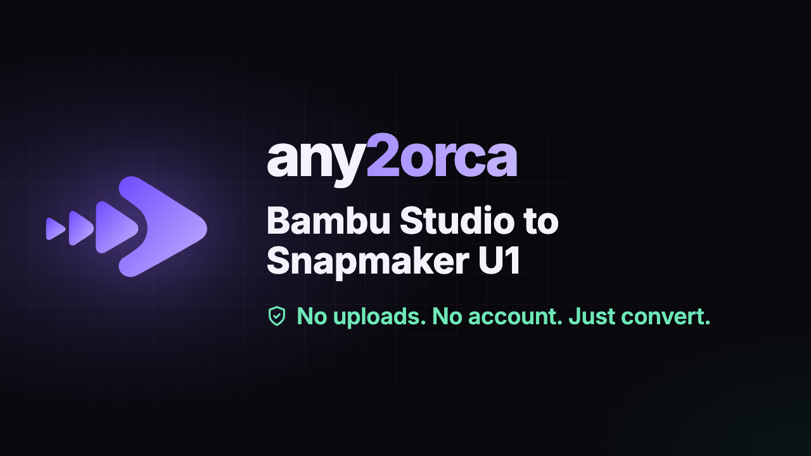

# any2orca

Convert Bambu Studio, Creality Print and Anycubic Slicer Next `.3mf` projects for the Snapmaker U1 (Snapmaker Orca), **entirely on your own machine.** Your file is never uploaded: the conversion runs in your browser, your terminal or your own code.

## Use it

| | |
|---|---|
| **In the browser** | Open [any2orca.com](https://any2orca.com), drop a `.3mf`, download the converted file. Nothing to install. |
| **Presets** | Your own print settings on other people's models: `any2orca presets add "My settings" tuned.3mf`, then `any2orca convert *.3mf --preset "My settings"`: [Presets](docs/presets.md). |
| **Compare settings** | `any2orca diff a.3mf b.3mf`, `any2orca diff model_U1.3mf --against-stock` on a converted file to see what a creator changed from Snapmaker's stock profile, or `--against-preset` to see what your preset would change: [Compare 3MF settings](docs/compare-settings.md). |
| **On the command line** | `npx any2orca convert model.3mf`, or `npm install -g any2orca`. Windows, macOS and Linux. Batches, watch folders and scripting: [CLI reference](docs/cli.md). |
| **In your own code** | `npm install any2orca any2orca-profiles`. A library for Node and browsers, plus a ready-made Web Worker: [`packages/core`](packages/core/README.md) and the [API reference](docs/README.md#api-reference). |
| **On your own server** | The web app is a folder of static files you can host anywhere, even offline: [run the web app yourself](docs/run-the-web-app.md). |
| **On your own site** | A link, a manifest, a `postMessage` hand-off or the embedded library: [integration guide](docs/integration-guide.md). |

## What a conversion does

- **Keeps your project intact.** Painted multi-color meshes are carried over byte for byte, every filament slot stays (none are dropped or merged), and the creator's tuning is kept.
- **Fits the U1.** Objects are recentered on the U1's bed, spaced to its clearance, and matched to the right Snapmaker profile for the nozzle size and layer height. When no profile matches your layer height exactly, the file keeps its own.
- **Handles the hotend and filament choices.** Say which of the four toolheads have the Snapmaker Liber High Flow Hotend, and optionally relabel filament names as Generic or Snapmaker presets for marketplace uploads (identity only, never temperatures or flow).
- **Tells you what it did.** Anything worth knowing, like objects moved closer together to fit, is shown with the result.
- **Says which version made it.** Each converted file carries one small note, [`Metadata/any2orca.json`](docs/output-stamp.md), with the any2orca version, profile and options. It exists so a file can be recognized if a bug is later found and fixed, and so bug reports are exact: paste it into an issue and I can see how the file was made, without your model. It holds nothing about you or your model, and you can leave it out (`--no-stamp`, or the checkbox in the web app).

## Your files stay yours

The library makes no network requests of its own; it loads profile data only from a source you give it. The CLI makes at most a daily version check, and anonymous usage stats only if you turn them on. The web app is a static site. [docs/privacy.md](docs/privacy.md) lists exactly what each part does and how to check it yourself, in a minute, in your own browser.

## What's in this repository

| | | License |
|---|---|---|
| [`packages/core`](packages/core) | `any2orca` on npm: the library, Web Worker and CLI | MIT |
| [`packages/profiles`](packages/profiles) | `any2orca-profiles` on npm: the printer profile catalog, tracking Snapmaker Orca's own presets | AGPL-3.0-or-later |
| [`apps/web`](apps/web) | The web app: a static site you can host yourself | AGPL-3.0-or-later |
| [`examples`](examples) | Working, tested examples: a batch script, a publish step, presets, a settings audit, What changed reports, reading the version note, a minimal UI, an embed, a browser extension, server configs, a stats collector | MIT |
| [`docs`](docs) | Guides and reference | |

Start with [docs/README.md](docs/README.md). Building your own front end, with or without an AI coding agent: [docs/build-your-own-ui.md](docs/build-your-own-ui.md). Looking for ideas of what to build or integrate: [docs/ideas.md](docs/ideas.md). Projects built on any2orca, and how to get yours listed: [docs/showcase.md](docs/showcase.md).

## Contributing

Issues and pull requests are welcome. [CONTRIBUTING.md](CONTRIBUTING.md) covers how to build and test, and why a profile update is a good first contribution. Please read the [Code of Conduct](CODE_OF_CONDUCT.md). Security problems: [SECURITY.md](SECURITY.md).

## History

any2orca continues bambu2orca (a web app) and its `@kuzuri.ao/b2o` command-line tool, whose conversion ran on a server. It's the same converter, now run locally: no account, no key, no quota, and nothing you convert is sent anywhere.

Some output changed on purpose with the move. Settings the creator never changed now get Snapmaker's real stock values (the old profiles carried personal tuning), files use Snapmaker's stock machine G-code, the 0.4 nozzle is recorded as stainless steel, speeds and filament flow are capped to what the U1 handles, and each file carries a small version note. The [changelog](packages/core/CHANGELOG.md) lists every change.

## Support

any2orca is free, with nothing held back for paying users. If it saves you time, you can leave a tip on [Ko-fi](https://ko-fi.com/kuzuriao/).

## License

The packages aren't all under the same license. [`LICENSE`](LICENSE) has the table, and [`NOTICE`](NOTICE) credits the third-party data. The profile data is AGPL-3.0-or-later because it is derived from Snapmaker's AGPL presets.

any2orca is an independent project. It is not affiliated with, endorsed by, or sponsored by Snapmaker, Bambu Lab, OrcaSlicer or any other printer, slicer or filament maker; their names are used only to say what any2orca works with.
